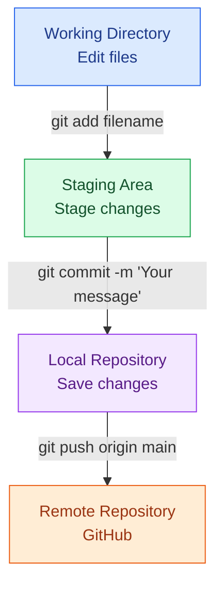

Git & GitHub Cheat Sheet

  

  A beginner-friendly, practical reference to the most commonly used Git and GitHub commands — from creating your first repository to collaborating with a team.

 
 <B> Introduction </B>
 
Git is one of the most widely used version control systems in software development.
 
This cheat sheet is designed to help developers understand Git commands, manage repositories, track code changes, work with branches and collaborate using GitHub.
 
<B>
Who is this for? </B>
 
Beginners learning Git for the first time,
 
Developers working on individual projects,
 
Engineers collaborating with development teams,
 
Anyone preparing for technical interviews,
 

<b> What is Git? (The Tracking Tool) </b> 

Git is a piece of software that runs locally on your own computer. It acts like a time machine for your project files 
• Tracks History: Every time you save your work (called a "commit"), Git takes a snapshot of your files.  
• Time Travel: If you make a mistake or break your code, you can easily roll back to a version that worked perfectly yesterday or last week. 
• Experiment Safely: You can create a copy of your project (called a "branch") to try out a new idea without messing up your main, working version.  

<b>What is GitHub? (The Online Hub)</b> 

GitHub is a cloud-based website. It does not replace Git; it works with Git.  
• Cloud Storage: It hosts your Git projects (called "repositories" or "repos") online so you don't lose them if your computer crashes. 
• Teamwork: It allows multiple people to download the project, make their own changes using Git, and upload them back to the main project. 
• Open Source: It is a social network for developers where millions of people share their code publicly for anyone to use or improve. 

## Git Workflow

---

  <b>⭐ If this cheat sheet helped you, consider giving this repository a star!</b>

  Made with ❤️ by <b>Devanshi Sharma</b>

  <i>Learn. Practice. Commit. Push. Repeat.</i>

